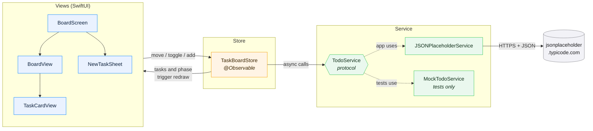
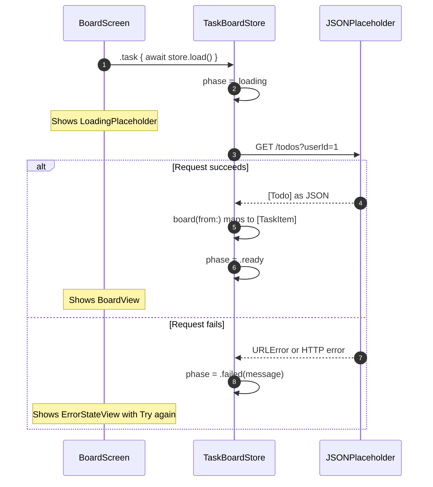
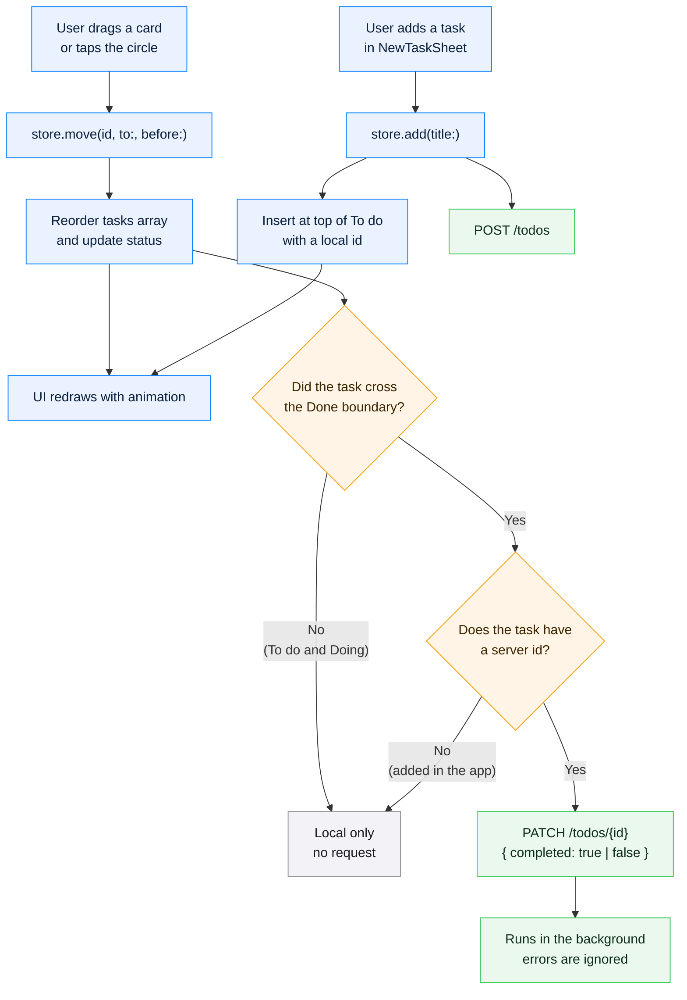
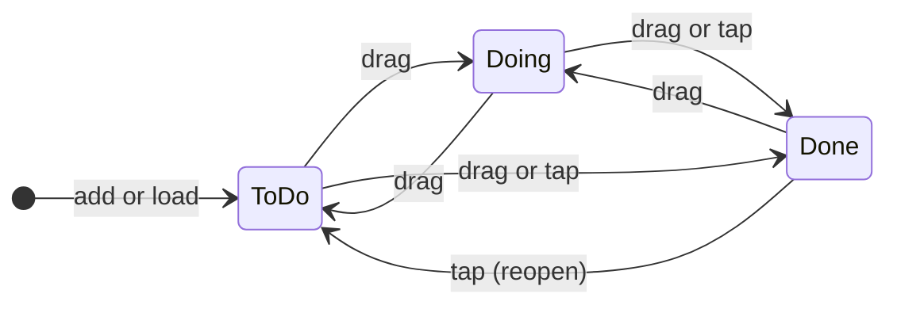

<div align="center">

# TaskBoard

**A drag-and-drop Kanban to-do app for iPhone and iPad, built with SwiftUI.**

A small, complete app for learning modern iOS development:<br>
networking, state management, drag and drop, adaptive layout, and unit tests.


[About](#about) ·
[Features](#features) ·
[Getting started](#getting-started) ·
[Project structure](#project-structure) ·
[How it works](#how-it-works) ·
[Concepts](#swift-and-swiftui-concepts) ·
[Exercises](#exercises)

</div>

---

## About

TaskBoard shows your tasks on a board with three columns: **To do**, **Doing**, and **Done**.
Tasks are loaded from the free [JSONPlaceholder](https://jsonplaceholder.typicode.com) REST API. You can drag cards between columns, reorder them, mark them complete, and add new ones.

The whole app is about **600 lines of Swift**, so you can read all of it in one sitting.

> [!NOTE]
> JSONPlaceholder is a **mock** API. It accepts `POST` and `PATCH` requests and responds as if they succeeded, but it never stores anything. Tapping **Reload** returns the board to its original state. This is expected behavior.

---

## Features

| Feature | Where to look |
|---|---|
| Loads tasks from a REST API with `async/await` | `Services/TodoService.swift` |
| Three-column Kanban board | `Views/BoardView.swift` |
| Drag and drop between and within columns, with an insertion indicator | `Views/BoardView.swift` |
| Tap the circle to complete or reopen a task | `Views/TaskCardView.swift` |
| Add a new task from a bottom sheet | `Views/NewTaskSheet.swift` |
| Columns stack in portrait and sit side by side in landscape | `Views/BoardView.swift` |
| Loading skeleton and error screen with a **Try again** button | `Views/StateViews.swift` |
| Unit tests with a mock service, so no network is required | `TaskBoardTests/` |
| App icon drawn in code, with light, dark, and tinted variants | `Design/make_icon.swift` |

---

## Getting started

### Requirements

- A Mac with **Xcode 16** or later (the project uses Swift 6)
- The iOS **17** simulator, or a device running iOS 17 or later
- An internet connection, so the app can fetch tasks

### Run the app

```bash
# 1. Clone the repository
git clone <your-repo-url>
cd To-Do

# 2. Open the project in Xcode
open TaskBoard.xcodeproj
```

3. Select an iPhone simulator from the device menu at the top of Xcode.
4. Press **Cmd + R** to build and run.

> [!TIP]
> To see the landscape layout, rotate the simulator with **Cmd + Left Arrow** or **Cmd + Right Arrow**.

### Run the tests

In Xcode, press **Cmd + U**. To run them from the terminal:

```bash
xcodebuild test \
  -project TaskBoard.xcodeproj \
  -scheme TaskBoard \
  -destination 'platform=iOS Simulator,name=iPhone 16'
```

---

## Project structure

```text
To-Do/
├── TaskBoard/
│   ├── TaskBoardApp.swift          App entry point; creates the store
│   ├── Models/
│   │   └── TaskItem.swift          TaskItem and TaskStatus (todo / doing / done)
│   ├── Services/
│   │   └── TodoService.swift       API client (GET, PATCH, POST)
│   ├── Store/
│   │   └── TaskBoardStore.swift    App state and logic: load, move, toggle, add
│   ├── Views/
│   │   ├── BoardScreen.swift       Main screen: header, buttons, loading / error / board
│   │   ├── BoardView.swift         Columns and drag and drop
│   │   ├── TaskCardView.swift      A single task card
│   │   ├── NewTaskSheet.swift      "New Task" bottom sheet
│   │   └── StateViews.swift        Loading skeleton and error screen
│   └── Assets.xcassets/            App icon and accent color
├── TaskBoardTests/
│   └── TaskBoardStoreTests.swift   Unit tests for the store
├── Design/
│   └── make_icon.swift             Script that draws the app icon
└── Task Board.html                 Interactive design prototype (open in a browser)
```

> [!TIP]
> **Suggested reading order:** `TaskItem` → `TodoService` → `TaskBoardStore` → `BoardScreen` → `BoardView` → `TaskCardView` → the tests.
> Read from the data layer up to the UI, then see how the tests verify it.

---

## How it works

### Architecture

The app is split into three layers, and each layer talks only to its neighbor.



| Layer | Responsibility | Depends on |
|---|---|---|
| **Views** | Render the screen and forward taps and drags to the store | The store |
| **Store** | Hold the list of tasks and decide what each action does | The `TodoService` protocol |
| **Service** | Send HTTP requests and decode JSON | The network |

Because the store depends on the `TodoService` **protocol** rather than the real API, tests can inject a `MockTodoService` and run without a network connection.

### Startup flow



### Action flow: what happens when you move a card

Every change is applied to the board **immediately**, then the store decides whether the server needs to hear about it. The server only tracks `completed`, so only moves that cross the **Done** boundary are sent.



The same rules as a reference table:

| Action in the app | Request sent |
|---|---|
| App opens, or **Reload** | `GET /todos?userId=1` |
| Move a task **into** Done | `PATCH /todos/{id}` with `{"completed": true}` |
| Move a task **out of** Done | `PATCH /todos/{id}` with `{"completed": false}` |
| Move between To do and Doing | None (local only) |
| Add a new task | `POST /todos` |
| Complete a task you added | None (it has no server id) |

### Task lifecycle



> [!NOTE]
> **Where does "Doing" come from on first load?** The API has no "in progress" state, so the store places up to two unfinished tasks whose id is divisible by 3 into **Doing**. This keeps the column from starting empty. See `TaskBoardStore.board(from:)`.

---

## Swift and SwiftUI concepts

<details>
<summary><b>1. <code>@Observable</code> and <code>@Environment</code>: sharing state</b></summary>

<br>

`TaskBoardStore` is marked `@Observable`. Any view that reads one of its properties redraws when that property changes. There is no need for `@Published` or `ObservableObject`.

The store is created once in the app and passed to every view through the environment:

```swift
// TaskBoardApp.swift
@State private var store = TaskBoardStore()

WindowGroup {
    BoardScreen()
        .environment(store)
}

// Any view can then read it:
@Environment(TaskBoardStore.self) private var store
```
</details>

<details>
<summary><b>2. <code>async/await</code> and <code>URLSession</code>: networking</b></summary>

<br>

```swift
func fetchTodos(userID: Int) async throws -> [Todo] {
    let url = baseURL.appending(path: "todos")
        .appending(queryItems: [URLQueryItem(name: "userId", value: String(userID))])
    let data = try await send(URLRequest(url: url))
    return try JSONDecoder().decode([Todo].self, from: data)
}
```

- `async` means the function can suspend while it waits for the network.
- `throws` means it can fail; the caller handles that with `do / catch`.
- `Codable` converts JSON into the `Todo` struct automatically.
</details>

<details>
<summary><b>3. Protocols and dependency injection: testable code</b></summary>

<br>

```swift
protocol TodoService: Sendable {
    func fetchTodos(userID: Int) async throws -> [Todo]
    func setCompleted(_ completed: Bool, todoID: Int) async throws
    func createTodo(title: String, userID: Int) async throws
}

init(userID: Int = 1, service: any TodoService = JSONPlaceholderService())
```

The app uses the real service by default. Tests inject a mock:

```swift
let store = TaskBoardStore(service: MockTodoService(todos: sample))
```
</details>

<details>
<summary><b>4. Enums with associated values: modeling screen state</b></summary>

<br>

```swift
enum Phase: Equatable {
    case loading
    case failed(String)
    case ready
}
```

The screen is always in exactly one of these states, and a `switch` decides what to show. It is impossible to be "loading and failed at the same time."
</details>

<details>
<summary><b>5. Drag and drop with <code>.draggable</code> and <code>.dropDestination</code></b></summary>

<br>

Each card is draggable and carries its `id` as a `String`:

```swift
TaskCardView(task: task)
    .draggable(task.id)
```

Each card **and** each column is a drop target. Dropping on a card inserts the task *before* that card; dropping on empty column space adds it *at the end*. A `DropTarget` struct records which zone the finger is over, so the insertion indicator is drawn in the correct place.
</details>

<details>
<summary><b>6. Adaptive layout with <code>GeometryReader</code></b></summary>

<br>

```swift
GeometryReader { proxy in
    let isLandscape = proxy.size.width > proxy.size.height
    ...
}
```

In portrait, the columns are stacked in a `ScrollView`. In landscape, they sit side by side in an `HStack`.
</details>

<details>
<summary><b>7. Unit testing with Swift Testing</b></summary>

<br>

```swift
@Test func movingIntoDoneSendsPatch() async {
    let (store, service) = await loadedStore()
    store.move("4", to: .done, before: "2")
    await store.waitForPendingRequest()
    #expect(ids(store, .done) == ["4", "2"])
}
```

- `@Test` marks a test function, and `#expect` checks a condition.
- `MockTodoService` is an `actor`, so it can safely record calls from many tasks at once.
- `waitForPendingRequest()` lets a test wait for the background request to finish before asserting.
</details>

<details>
<summary><b>8. UI polish</b></summary>

<br>

- `withAnimation(.snappy)` animates cards moving between columns.
- `.contentTransition(.numericText())` animates the task counters.
- `.presentationDetents([.height(180)])` creates a compact bottom sheet.
- `@FocusState` opens the keyboard as soon as the sheet appears.
- `.accessibilityLabel` makes icon-only buttons work with VoiceOver.
</details>

---

## Exercises

Practice challenges, ordered from easiest to hardest.

| Level | Challenge | Hint |
|---|---|---|
| Easy | Change the app's accent color | `Assets.xcassets/AccentColor.colorset` |
| Easy | Show tasks from another user (2–10) | `TaskBoardStore(userID:)` |
| Medium | Add swipe-to-delete on a card | `.swipeActions` plus a new `delete(_:)` in the store |
| Medium | Add a search bar that filters cards by title | `.searchable` plus a computed property |
| Medium | Write a test for your new feature | Start from an existing test in `TaskBoardStoreTests.swift` |
| Hard | Persist tasks on the device so they survive a restart | SwiftData, or `Codable` with `FileManager` |
| Hard | Add a fourth column, such as **Blocked** | `TaskStatus` enum (the layout adapts automatically) |
| Hard | Show an error banner when a `PATCH` fails instead of ignoring it | See `try?` in `syncCompletion` |

---

## Troubleshooting

<details>
<summary><b>The app shows "Couldn't load tasks – Check your connection."</b></summary>

The simulator has no internet access, or `jsonplaceholder.typicode.com` is blocked on your network. Check your connection and tap **Try again**.
</details>

<details>
<summary><b>New tasks disappear when I tap Reload.</b></summary>

This is expected. JSONPlaceholder simulates saving data but never stores it. See the note in [About](#about).
</details>

<details>
<summary><b>Build error about the Swift version or <code>count(where:)</code></b></summary>

You are using an older version of Xcode. Update to **Xcode 16 or later**.
</details>

<details>
<summary><b>How do I regenerate the app icon?</b></summary>

```bash
swift Design/make_icon.swift TaskBoard/Assets.xcassets/AppIcon.appiconset
```
</details>

---

## Further reading

- [SwiftUI Tutorials (Apple)](https://developer.apple.com/tutorials/swiftui)
- [Observation framework](https://developer.apple.com/documentation/observation)
- [Swift Testing](https://developer.apple.com/documentation/testing)
- [Drag and drop in SwiftUI](https://developer.apple.com/documentation/swiftui/drag-and-drop)
- [JSONPlaceholder guide](https://jsonplaceholder.typicode.com/guide/)

---

<div align="center">

Built with SwiftUI by **Sokreaksmey Deap**.

</div>
